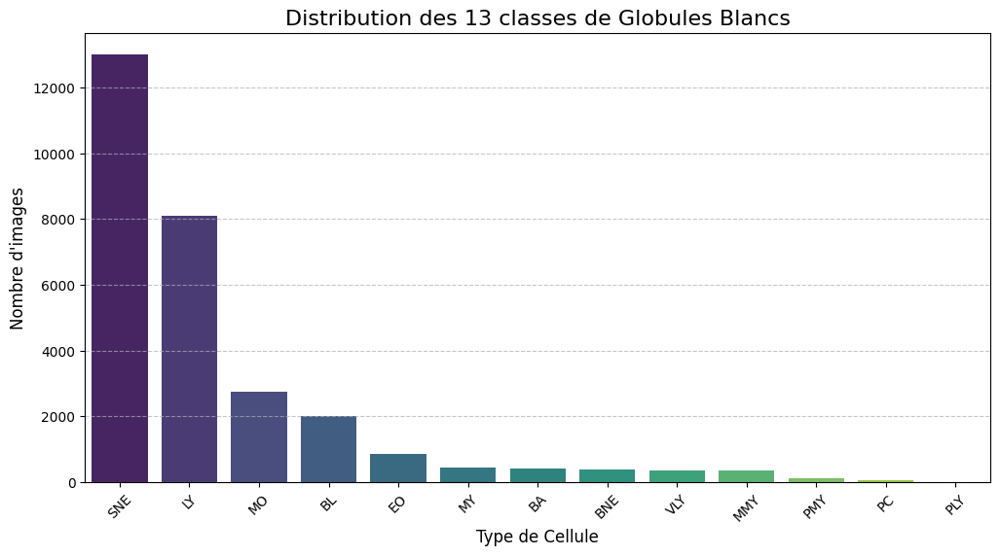

# White Blood Cell Classification — IMA205

Project for the IMA205 course (Télécom Paris): classify microscopic images of
white blood cells (leukocytes) into **13 morphological classes** (Kaggle challenge,
metric: **Macro F1**).

The dataset (28,901 images) is highly imbalanced: SNE and LY account for ~73% of the images,
PLY for less than 0.05%. Two approaches are compared:

1. **Classical ML**: 15 handcrafted features (HSV color, shape, GLCM texture)
   fed to LightGBM / SVM.
2. **Transfer learning**: ImageNet-pretrained ResNet18 / ResNet50, with a class-weighted
   loss and data augmentation.

The full report (in French) is in [docs/Rapport_IMA205_Tabouri_Lukas.pdf](docs/Rapport_IMA205_Tabouri_Lukas.pdf).



## Results (public Kaggle leaderboard)

| Model | Approach | Macro F1 |
|---|---|---|
| SVM RBF (15 features) | Classical ML | 0.21 (CV) |
| LightGBM (15 features) | Classical ML | 0.26 (CV) |
| ResNet50 (25 epochs) | Deep learning | 0.6213 |
| ResNet18 V2 + TTA (3 views) | Deep learning | 0.6296 |
| ResNet18 V1 (10 epochs) | Deep learning | 0.6350 |
| Fine-tuning on 100% of the data | Deep learning | 0.6755 |
| **ResNet18 V2** (25 epochs, weighted loss, strong augmentation) | Deep learning | **0.7030** |

## Project structure

```
wbc/
  config.py      constants, dataset paths, device selection
  data.py        metadata, PyTorch Dataset, transforms, class weights
  features.py    extraction of the 15 handcrafted features   (python -m wbc.features)
  classical.py   LightGBM / SVM with 5-fold cross-validation (python -m wbc.classical)
  models.py      ResNet, training loop, inference (+ TTA)
  train.py       ResNet training                              (python -m wbc.train)
  predict.py     Kaggle submission generation                 (python -m wbc.predict)
notebooks/
  eda.ipynb      exploratory data analysis
docs/            PDF report and figures
```

## Setup

```bash
python -m venv .venv
.venv\Scripts\activate          # Windows  (source .venv/bin/activate on Linux/macOS)
pip install -r requirements.txt
```

For GPU support, install PyTorch with the right CUDA version from [pytorch.org](https://pytorch.org/get-started/locally/).

The dataset is not versioned. Put the challenge files at the repository root:

```
IMA205-challenge/
  train/                 training images
  test/                  test images
  train_metadata.csv     ID, label
  test_metadata.csv      ID
```

(another location can be passed with `--data-dir`). All generated files
(features, `.pth` weights, submissions) are written to `outputs/`.

## Reproducing the experiments

**Classical ML baseline**

```bash
python -m wbc.features
python -m wbc.classical --model lightgbm
python -m wbc.classical --model svm
```

**ResNet18 V1** (baseline: 10 epochs, light augmentation, no class weighting)

```bash
python -m wbc.train --arch resnet18 --epochs 10 --augment light --output outputs/resnet18_v1.pth
```

**ResNet18 V2** (best model: 25 epochs, weighted loss, strong augmentation, best checkpoint)

```bash
python -m wbc.train --arch resnet18 --epochs 25 --augment strong --class-weights --output outputs/resnet18_v2.pth
```

**ResNet50** (same pipeline, batch size 16 to fit in GPU memory)

```bash
python -m wbc.train --arch resnet50 --epochs 25 --batch-size 16 --augment strong --class-weights
```

**ResNet18 + scheduler** (`ReduceLROnPlateau` on Macro F1, or `cosine` for CosineAnnealingLR)

```bash
python -m wbc.train --arch resnet18 --epochs 35 --augment strong --class-weights --scheduler plateau --output outputs/resnet18_plateau.pth
```

**Fine-tuning on 100% of the data**, starting from V2

```bash
python -m wbc.train --arch resnet18 --full-data --init-weights outputs/resnet18_v2.pth --epochs 3 --lr 1e-5 --augment strong --class-weights --output outputs/resnet18_v2_full.pth
```

**Kaggle submission** (add `--tta` to average original + horizontal flip + vertical flip)

```bash
python -m wbc.predict --weights outputs/resnet18_v2.pth
```

```bash
python -m wbc.predict --weights outputs/resnet18_v2.pth --tta
```

## Notes

- The challenge only allows **ImageNet**-pretrained weights
  (no pretraining on medical images).
- The train/validation split is a stratified 80/20 split with `random_state=42`.
- The report mentions a `CosineAnnealingLR` for ResNet18 V2, but the original notebook
  trained V2 with a fixed learning rate; the scheduler is therefore optional (`--scheduler`).
